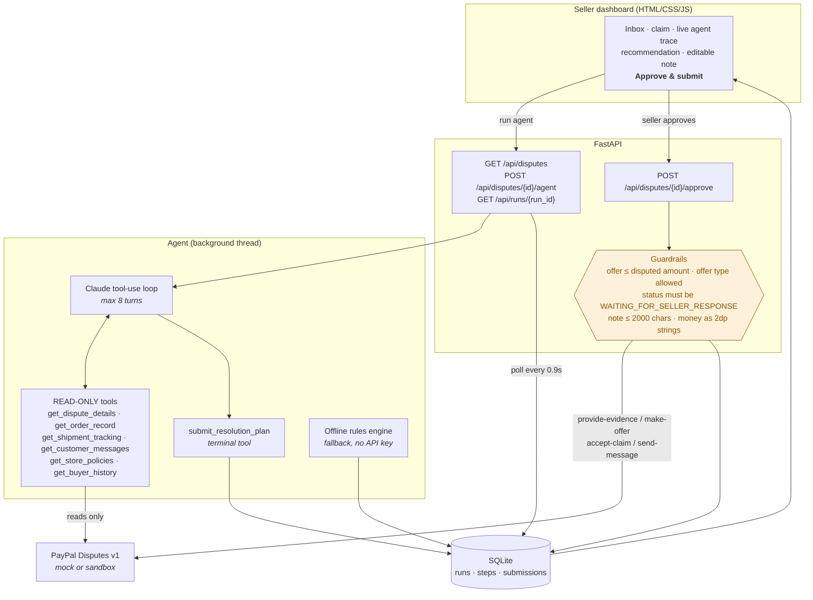

# DisputeDesk

**An AI agent that handles PayPal disputes and chargebacks for small online sellers.**

Built for the PayPal AI Hackathon on Devpost.

---

## The problem

A PayPal dispute lands and a small seller has roughly ten days to respond. Doing it properly
means pulling the order, finding the carrier tracking, checking whether a signature was
captured, digging out any refund already issued, re-reading what the buyer said, deciding
whether to contest, settle or concede — and then writing a response PayPal's reviewer will
accept. It takes about 45 minutes per dispute, and it is the work sellers put off.

So they do one of two bad things. They **accept everything**, refunding money they did not owe —
including the duplicate charge they already refunded. Or they **fight everything**, losing
disputes they were always going to lose and pushing their dispute rate toward the threshold
where PayPal starts holding funds.

The decision is not actually hard. It just requires reading six records and being honest about
what they say. That is what DisputeDesk does.

## What it does

For each dispute the agent reads the PayPal record and the seller's own store data — order,
carrier tracking, buyer messages, store policies, refunds, buyer history — and returns one of
three recommendations:

| Action | When | Example from the demo data |
|---|---|---|
| **FIGHT** | Documented evidence supports the seller | $149 headphones: tracking shows delivered, signed for, photographed |
| **OFFER** | The buyer has a real but partial grievance | $62 mug set, one of four chipped → offer $15.50, the value of the one mug |
| **ACCEPT** | The evidence is against the seller | $38 tea towels: the carrier never collected the parcel |

Each plan comes with the reasoning, the exact evidence to file, a response note written for
PayPal's reviewer, a message for the buyer, and the risks of approving it.

**Nothing reaches PayPal until the seller clicks Approve.** The agent's tools are read-only; it
cannot call PayPal at all. Every write goes through server-side guardrails.

## Architecture



The agent gathers evidence; the human decides; the server enforces the rules. The agent never
holds a credential that can change anything.

## Quick start

```bash
git clone <this repo> && cd disputedesk
python3 -m venv .venv && source .venv/bin/activate
pip install -r requirements.txt
uvicorn app.main:app --reload
```

Open <http://127.0.0.1:8000>. That is the whole setup — no API keys, no PayPal account.
It starts in **mock mode** with five realistic disputes and runs the offline rules engine,
clearly labelled in the header.

### Turn on the actual agent

```bash
export ANTHROPIC_API_KEY=sk-ant-...
uvicorn app.main:app --reload
```

The header badge switches to the model name and the trace shows the real tool calls, the
records returned and the token count per turn.

Configuration can go in a `.env` file instead — copy `.env.example` to `.env`. The app reads it
on startup, and real environment variables always take precedence over the file:

| Variable | Default | Notes |
|---|---|---|
| `ANTHROPIC_API_KEY` | *(unset)* | Unset → offline rules engine, labelled in the UI |
| `CLAUDE_MODEL` | `claude-sonnet-5-5` | Any current Claude model |
| `CLAUDE_EFFORT` | `medium` | Dropped automatically if the model rejects it |
| `MAX_AGENT_TURNS` | `8` | Turn ceiling for the loop |
| `PAYPAL_MODE` | `mock` | `mock` or `sandbox` |
| `PAYPAL_BASE_URL` | `https://api-m.sandbox.paypal.com` | |
| `PAYPAL_CLIENT_ID` / `PAYPAL_CLIENT_SECRET` | *(unset)* | Required for `sandbox` |
| `SELLER_STORE_FILE` | `data/store.json` | Your own order records, read in `sandbox` mode |

### Run against the real PayPal sandbox

1. Create a sandbox REST app at
   [developer.paypal.com](https://developer.paypal.com/dashboard/applications/sandbox) and
   enable **Dispute Management** under Features.
2. Put the client ID and secret in `.env`.
3. Check them:
   ```bash
   python scripts/sandbox_check.py
   ```
   It gets a token, lists your disputes, and tells you exactly what is wrong if anything is.
4. Give the agent something to read. PayPal holds the dispute; your orders, tracking and
   refunds live in your own systems, so DisputeDesk reads them from a JSON file:
   ```bash
   cp data/store.example.json data/store.json
   ```
   Edit it with your real orders. Each record is matched on any of `match.dispute_id`,
   `match.invoice_number`, `match.transaction_id` or `order.order_id`, so you can file a record
   under your own order number before the dispute exists. Every section is optional — the agent
   is told when a record is missing and raises it as a risk flag rather than inventing one.
   (`data/store.json` is gitignored; swap `SellerStore.lookup` for a database query in a real
   deployment.)
5. Run with `PAYPAL_MODE=sandbox`.

**Creating a sandbox dispute to work on:** sandbox accounts start with none.
Log in to [sandbox.paypal.com](https://sandbox.paypal.com) as your sandbox **buyer**, pay your
sandbox seller account, then open **Activity → the transaction → Report a Problem** and file a
claim. It appears in `GET /v1/customer/disputes` within a minute or two. Dispute flows can take
a few minutes to reach `WAITING_FOR_SELLER_RESPONSE`, which is the only status PayPal accepts a
seller response in — and which DisputeDesk checks before it sends anything.

## For judges

The fastest meaningful run, no keys needed:

```bash
pip install -r requirements.txt && uvicorn app.main:app
```

1. Open <http://127.0.0.1:8000>. Five disputes, $693.50 at risk.
2. Click **Stoneware Mug Set** → **Run agent**. Watch the trace read the order, the tracking
   and the store policy, then recommend **OFFER $15.50** — one mug of four, not the whole set.
3. Try to over-refund: change the offer to `999.00` and approve. The server returns **422** and
   nothing is sent. That guardrail runs server-side, not in the model.
4. Set it back to `15.50` and approve. You see the exact `POST .../make-offer` body and
   PayPal's response, and the header's **Protected** figure moves.
5. Click **Linen Tea Towels** → **Run agent**. It recommends **ACCEPT**: the carrier never
   collected the parcel, so there is nothing to defend. An agent that said FIGHT to everything
   would be worse than useless here.

With `ANTHROPIC_API_KEY` set, the same flow runs through Claude and the trace is the model's
own tool calls.

## Tests

```bash
pytest -q        # 101 tests, no API key and no network
```

Covers the guardrails (over-refunds, disallowed offer types, closed disputes, note length), the
mock PayPal API, the rules engine against all five fixtures, plan normalisation, the full
HTTP approve flow, `.env` loading and the seller store adapter.

Two parts are worth calling out, because they are the parts that talk to someone else:

- **The Claude loop** is driven against a stubbed SDK that scripts the model's responses —
  including parallel tool calls, a turn that ends without the final tool, a refusal, a model
  that never submits at all, and a plan that tries to over-refund.
- **The real PayPal client** is driven through `httpx.MockTransport`, asserting the exact wire
  shapes: OAuth client-credentials with basic auth, token caching and refresh, bearer headers,
  the `multipart/form-data` body with a JSON part named `input` for provide-evidence, and the
  documented JSON bodies for make-offer, accept-claim and send-message.

## Notes on the agent loop

- **The final tool is not forced by `tool_choice`.** Claude Sonnet 5.5 and the other current
  models reject `tool_choice: {"type": "any"|"tool"}` with a 400. Instead the tool is named in
  the system prompt, and a turn that ends without it gets one explicit instruction to call it.
  If it still does not, the rules engine fills in and the plan is labelled as such — the UI
  never shows an empty result.
- **Tool results from one turn go back in a single user message**, so parallel tool use keeps
  working.
- **Every step is written to SQLite as it happens**, which is what lets the dashboard poll a
  live trace while the run is still going, and what makes a finished run reviewable afterwards.
- **Plans are normalised before they are shown**: confidence clamped, notes truncated, offers
  capped at the disputed amount and switched to an allowed offer type, with each correction
  added to the risk flags the seller reads.

## Deploying

`render.yaml` is included — point Render at the repo and set `ANTHROPIC_API_KEY`,
`PAYPAL_CLIENT_ID` and `PAYPAL_CLIENT_SECRET` in the dashboard. Secrets are marked
`sync: false`, so they are never in the repo.

## Licence

MIT — see [LICENSE](LICENSE).
